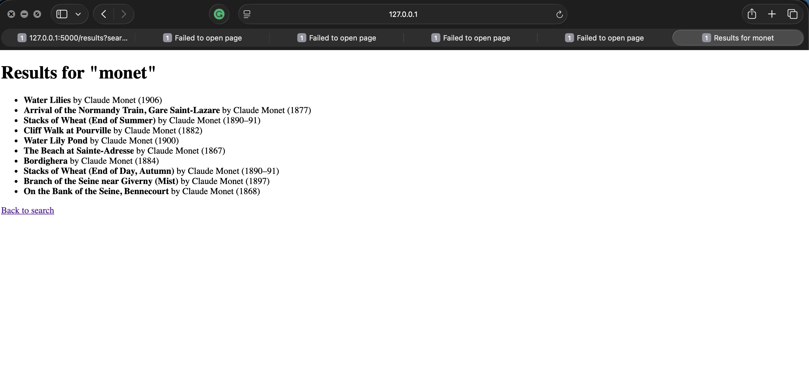

# Art Search

**Who it's for:** Art students who want to quickly look up artworks from the Art Institute of Chicago and see who made them and when, so they can study artists' choices.

## How to run
1. Turn on the virtual environment and install the packages:
   `pip install flask requests`
2. Go into the hw4 folder:
   `cd hw4`
3. Start the app:
   `flask --app app run --port 5001`
4. Open http://127.0.0.1:5001 in your browser and search for an artist or artwork, like "monet".

## Screenshot
