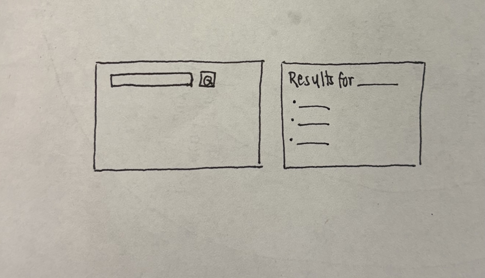

# AI Log

## What surprised me
- The Art Institute search uses fuzzy matching, so even nonsense words like "zzzzqqq" returned artworks. I had to test the "no results" state with a temporary `return []` instead
- When Safari said "can't connect," my code was fine. The Flask server had stopped, or I was on the wrong port or in the wrong folder.

## What I changed
- I wrote the `/` route and `home.html` myself. AI only fixed my label/input `id` so they match, and pointed out mistakes (folder had to be `templates`, `artworks=artworks` would cause a NameError).
- I kept artworks that are missing fields and show "Unknown artist" / "Unknown date" instead of removing them, like my HW3 code.
- I added `--port 5001` because port 5000 is used by AirPlay on my Mac.

## AI chats
this is my next homework. Explain to me in plain english and guide me each step with simple explanation

for reference, here is my past work:
this is one of my hw in my hw3, u can go through the other documents as well in hcde310/hw3

```python
# HW3 Part 2 + Part 3 + Part 4
#
# Instructions: README.md in this folder (same as the assignment on Canvas).

import requests

FIELDS = "id,title,artist_title,artist_display,date_display,place_of_origin,dimensions,thumbnail"


# Functions go here (above the code that runs)
# PART 3
def count_by_artist(results):
    """Returns a dictionary of counts by artist"""
    counts = {}
    for art in results:
        a = art.get("artist_title") or "Unknown"
        counts[a] = counts.get(a, 0) + 1
    return counts

# PART 4
def save_results(artworks, filename):
    with open(filename, "w") as f:   
        for art in artworks:
            titles = art.get("title") or "Untitled"
            artist = art.get("artist_title") or "Unknown Artist"
            date = art.get("date_display") or "Unknown date"
            f.write(f"{titles} by {artist} on {date}")

# PART 2
# how to write a url in python
term = input("Search the Art Institute for: ")

url = "https://api.artic.edu/api/v1/artworks/search"
params = {"q": term, "fields": FIELDS}
headers = {""} # the part that has email here
response = requests.get(url, params=params, headers=headers)


if response.status_code != 200:
    print(f"sorry the search didn't work: {response.status_code} {response.reason}")
else:
    data = response.json() # turns the json to py
    results = data["data"]
    if len(results) == 0:
        print(f"No artworks found for '{term}'. Try another word.")
    else:
        for art in results:
            titles = art.get("title") or "Untitled" # or fits both case when value is null & when its empty
            artist = art.get("artist_title") or "Unknown Artist"
            display = art.get("artist_display") or "Unknown Display"
            date = art.get("date_display") or "Unknown date"
            place = art.get("place_of_origin") or "Unknown place"
            size = art.get("dimensions") or "Unknown size"
            thumb = art.get("thumbnail") or {}
            description = thumb.get("alt_text") or "No description"
            print(f"{titles} ({date}) by {artist}")
            print(f"  Artist info: {display}")
            print(f"  From: {place}")
            print(f"  Size: {size}")
            print(f"  Image: {description}")
            print()

        print("Artworks per artist:", count_by_artist(results))
        save_results(results, "ResultStorage.txt")   


# TODO steps 4-5: loop over the results and print each one (reuse your HW2 printing code),
#                 print a default for null fields, and print a helpful message if there are no results


   
```

Ive made some documents called class-9 (im pretty sure this is somehow related to it

```python
# api.py

import requests
def find_books(author):
   r = requests.get("https://openlibrary.org/search.json",
                    params={"author": author}, timeout=10)
   return r.json()["docs"][:10]
```


```python
# app.py

from flask import Flask, render_template, request
from api #what
app = Flask(__name__)

@app.route("/")
def home():
   artworks = [{"title":"Lilies"},
               {"title":"Nighthawks"}]
   return render_template("home.html", artworks=artworks)

@app.route("/about")
def about():
   return "About us"

@app.route("/books")
def books():
   return render_template("books.html")

@app.route("/results")
def results():
   author = request.args.get("author_search", "")
   return render_template("results.html",
                          books=find_books(author))

```


```html
<!-- templates/books.html -->
<form action="/results" method="get">
   <label>Author</label>
   <input name="author_search">
   <button type="submit">Find books</button>
</form>


```


```html
<!-- templates/home.html -->


<p>{{ art.title }}</p>

```


```html
<!-- templates/results.html -->


<p>{{ book.title }}</p>

```

This homework is basically **your HW3 art search, turned into a website**, using the same steps you just practiced in In-class 10. The new part is that you **plan first**, before writing code.

## The big picture

In HW3, your program used `input()` to ask for a search word and `print()` to show results in the terminal. In HW4:
- `input()` becomes a **search form** on a web page
- `print()` becomes a **results page**

The data still comes from the **Art Institute of Chicago API**, using your HW3 code.

## The files you'll have

| File | What goes in it |
|---|---|
| `plan.md` | Your sketch, the data you need, and specs (written **first**) |
| `api.py` | Your HW3 API code, inside a function like `search_art(term)` |
| `app.py` | The routes: `/` (search form) and `/results` |
| `templates/home.html` | The search page |
| `templates/results.html` | The results page |
| `ai_log.md` | Your AI chats, pasted, plus what surprised you and what you changed |
| `README.md` | Who it's for, how to run it, a screenshot |

## The AI rules (important)

- **Stage 3**: AI can help with **at most one function per prompt**.
- **You must write the `/` route and `home.html` yourself.** I'll explain, but I won't write those for you.
- Any code AI writes gets an **`# AI-written`** comment.
- **This chat counts.** You'll paste it into `ai_log.md`.

## The steps, in order

1. **Sketch** a search page and a results page on paper, then take a photo.
2. **List the data**: which fields from the API you'll show, like title, artist, and date.
3. **Spec each piece**: for each function or route, what goes in, what comes out, and 2–3 checks to try in the browser.
4. **Pseudocode**: write the steps as `#` comments in `app.py`.
5. **Skeleton**: get form → `/results` → results page working with **fake data**, exactly like In-class 10.
6. **One piece at a time**: swap in the real API, handle the 4 states, and commit each time something works.
7. **Finish**: accessibility, your own comments, README, and ai_log.

Steps 1–3 go in `plan.md`, step 4 goes in `app.py`, and all of it comes **before** the code.

**Good news:** you've already done most of the hard thinking. Your HW3 code already handles errors (`status_code != 200`), no results (`len(results) == 0`), and missing fields (`or "Unknown"`). And In-class 10 showed you how to turn those into messages on a page.

---

## Let's start: Steps 1–2

**Step 1: Sketch.** On paper, draw 2 boxes:
- **Search page:** a title, a label like "Search for art," a text box, and a button.
- **Results page:** for each artwork, what you'd show (like a small image, title, artist, and date), plus a link back to search.

Keep it simple. The assignment says "bare minimum."

**Step 2: The data.** Look at your HW3 `FIELDS` line. You don't need all of them. Which ones would actually help someone on the results page?

```
id, title, artist_title, artist_display, date_display, place_of_origin, dimensions, thumbnail
```

**Your turn:** pick the fields you want to show and tell me why each one is useful. Also tell me **who the app is for** (like your ARTWHY idea for art students, or someone else). That one sentence will guide the rest of your plan.

(attached sketch)
is my drawing enough to give information and start assignment, what do i do next

Yes, your sketch is enough to start. It shows the two screens the assignment asks for: a search page and a results page. It's the "bare minimum" version, which is allowed.

**Optional: add a few quick labels in pen** so the sketch matches your plan. These take two minutes and support points elsewhere in the rubric:
- **Search page:** a page title (like "Art Search"), a label above the box ("Search for art", which counts toward accessibility), and a spot for a message ("Please type a word").
- **Results page:** next to one bullet, write what it shows, like *title, artist, date*. Add a "← Back to search" link at the bottom.

## Next step: start `plan.md`

**1. Add the photo.** Save it in your `hw4` folder as **`sketch.jpg`**, not `.heic`, because GitHub can't show HEIC files. On a Mac, open it in Preview, choose **File → Export**, and pick **JPEG**.

**2. Make `plan.md`** with this structure. Fill in the parts in brackets yourself. This plan is meant to be your own thinking, so I'm giving you the shape and one example only.

```markdown
# HW4 Plan

## Who it's for
[One sentence: who uses this, and what for?]

## 1. Sketch


## 2. Data I need
From the Art Institute API, for each artwork:
- title: [why the user needs it]
- artist_title: [why]
- date_display: [why]
- [any others?]

## 3. Specs

### search_art(term) in api.py
- In: a search word (string)
- Out: a list of artwork dictionaries, or None if the API fails
- Checks:
  1. Search "monet" → see a list of Monet artworks
  2. Break the URL → returns None, and the page shows an error message
  3. Search "zzzzqqq" → returns an empty list

### / route (home)
- In: [nothing / a message?]
- Out: [which template?]
- Checks: [2–3 things you'll try in the browser]

### /results route
- In: [what does it read from the form?]
- Out: [what does it show? what happens in each bad state?]
- Checks: [empty form, nonsense word, normal search…]
```

The `search_art` spec is filled in as an example. The `/` route and `/results` route specs are yours to write, using In-class 10 as a guide (the 4 states there are the same 4 you need here).

**Tip:** for "Data I need," look at your HW3 `FIELDS` line and keep only 3–4 fields. Pick ones where one could be **missing**, like `date_display`, so you can show the "missing field" state.

When you've drafted it, paste it here and I'll check it against the rubric before you move on to the pseudocode.

id like to keep my photo the way it is now. 

```markdown
# HW4 Plan

## Who it's for
Anyone who wants to look up artworks from Chicago Art Institude and find details about it through a simple web

## 1. Sketch


## 2. Data I need
From the Art Institute API, for each artwork:
- title: User needs to be able to identify the artwork title
- artist_title: Giving credits to the artist to learn more about them and their artistic choices
- date_display: Understand context in which the artwork was created

## 3. Specs

### search_art(term) in api.py
- In: a search word (string)
- Out: a list of artwork dictionaries, or None if the API fails
- Checks:
  1. Search "monet" → see a list of Monet artworks
  2. Break the URL → returns None, and the page shows an error message
  3. Search "zzzzqqq" → returns an empty list

### / route (home)
- In: [nothing / a message?]
- Out: [which template?]
- Checks: [2–3 things you'll try in the browser]

### /results route
- In: User input?
- Out: "Results not found. Try another artwork."
- Checks: [empty form, nonsense word, normal search…]
```


Can u check, help me revise, and explain what ure doing after

Your plan is in good shape. The data section is clear, and the `search_art` spec is done. Three things needed work: "who it's for" was too broad, the `/` route was still empty, and the `/results` route mixed up "in" and "out."

## Revised plan.md

```markdown
# HW4 Plan

## Who it's for
Art students who want to quickly look up artworks from the Art Institute of Chicago and see who made them and when, so they can study artists' choices.

## 1. Sketch


## 2. Data I need
From the Art Institute API, for each artwork:
- title: so the user can identify the artwork
- artist_title: to credit the artist, so the user can learn more about them and their artistic choices
- date_display: to understand the context the artwork was made in

Some artworks are missing these fields, so I'll show a default instead:
"Untitled", "Unknown artist", or "Unknown date".

## 3. Specs

### search_art(term) in api.py
- In: a search word (string)
- Out: a list of artwork dictionaries, or None if the API fails
- Checks:
  1. Search "monet" → see a list of Monet artworks
  2. Break the URL → returns None, and the page shows an error message
  3. Search "zzzzqqq" → returns an empty list

### / route (home)
- In: nothing (or a message, when /results sends the user back)
- Out: home.html with a labeled search box and a Search button, plus the message if there is one
- Checks:
  1. Open http://127.0.0.1:5000 → see the search form
  2. Press Tab → focus moves to the search box, then the button
  3. Submit an empty form → come back here and see "Please type a search word."

### /results route
- In: the search word the user typed in the form
- Out: results.html listing each artwork's title, artist, and date.
  If something goes wrong, go back to home.html with a message:
  - empty input → "Please type a search word."
  - API error → "We couldn't reach the Art Institute right now. Please try again later."
  - no results → "No artworks found for '___'. Try another word."
- Checks:
  1. Search "monet" → see Monet artworks with title, artist, and date
  2. Search "zzzzqqq" → see the "No artworks found" message
  3. An artwork with no date → shows "Unknown date" instead of a blank
```

## What I changed, and why

**1. "Who it's for":** "Anyone" is too broad. A specific group gives your app a clear purpose and makes the README sentence easy. I used **art students**, since your data reasons already talk about "artistic choices," and it matches your ARTWHY idea. I also fixed the typo "Institude."

**2. Data:** I added a line about **missing fields**. That's one of the 4 required states, and your plan should say how you'll handle it. These are the same defaults from your HW3 code (`or "Unknown date"`).

**3. `/` route:** I filled it in. It doesn't take input itself; it just shows the form. It can also receive a message when `/results` sends the user back. The Tab check covers the **accessibility** part of the rubric.

**4. `/results` route:**
- **In:** the user's search word. You had "User input?", which was right, so I just made it specific.
- **Out:** you had only the "not found" message. But "out" should first describe the **normal** result (the list), then each bad state with its message. That covers 3 of the 4 states here. The 4th (missing field) is in the checks.
- **Checks:** I made each one something you can **actually try** in the browser and mark pass or fail later.

## One thing to check

The link `sketch.jpg` must match your photo's real filename. If your photo is still `IMG_7776.heic`, either rename it or change the link. Also, GitHub can't display `.heic` files, so the grader may see a broken image. Exporting it as JPEG doesn't change how the drawing looks; it only changes the file type.

**Next step: pseudocode.** Write the steps for `/results` as `#` comments in `app.py`, before any code. Try it yourself first. It's very similar to the numbered comments from In-class 10.

Ok, next.

This is what I have in app.py so far taken from inclass10 and class9, idk how I should start and decide which I should use.


```python
# app.py

from flask import Flask, render_template, request
from api
app = Flask(__name__)

@app.route("/")
def home():
   artworks = [{"title":"Lilies"},
               {"title":"Nighthawks"}]
   return render_template("home.html", artworks=artworks)

@app.route("/about")
def about():
   return "About us"

@app.route("/books")
def books():
   return render_template("books.html")

@app.route("/results")
def results():
   author = request.args.get("author_search", "")
   return render_template("results.html",
                          books=find_books(author))

# app.py: the routes for the books app.
# SKELETON: the whole path works (form → /results → results page) with fake data.
# Next: replace one piece at a time, and commit each time something works.
from flask import Flask, render_template, request   # request (Flask), not requests!
from api import get_books_real


app = Flask(__name__)


@app.route("/")
def home():
    return render_template("home.html")


@app.route("/results")
def results():
    # 1. Read the search term from the form
    author = request.args.get("author_search", "")

    # 2. Empty input? → home page + message (check BEFORE calling the API)
    if author.strip() == "":
        return render_template("home.html", message="Please type an author's name to search.")

    # 3. Call the API (fake data for now)
    books = get_books_real(author)

    # 4. API error? (get_books returned None) → home page + message
    if books is None:
        return render_template("home.html", message="We couldn't reach the book database right now. Please try again in a few minutes.")

    # Missing fields: keep only books that have a title
    good_books = []
    for book in books:
        if book.get("title"):
            good_books.append(book)
    books = good_books

    # 5. No results, or nothing useful to show? → home page + message
    if len(books) == 0:
        return render_template("home.html", message=f"No books found for \"{author}\". Check the spelling or try another author.")

    # 6. Otherwise → results page
    return render_template("results.html", books=books, author=author)

```

Use the **In-class 10 version (the bottom half)** as your model. It already has the right shape: a search form, a `/results` route, and the 4 states. The top half is from Class 9, where you were just learning routes, so you don't need `/about`, `/books`, or the fake artworks list in `home()`.

**Start a fresh `app.py` for HW4** (in your `hw4` folder, not the in-class one). Right now this step is **only comments**, which is the "pseudocode" part of the assignment. You'll write the code underneath each comment later.

## Step 4: Pseudocode

Here are your plan's specs turned into steps. Read through them and change any wording so it sounds like you:

```python
# app.py: routes for my art search app.
# Who it's for: art students looking up artworks from the Art Institute of Chicago.

# Import Flask tools (Flask, render_template, request)
# Import my search_art function from api.py

# Create the app


# ---------- / (home) ----------
# Show home.html, which has the search form.
# (If /results sends the user back with a message, home.html shows it.)


# ---------- /results ----------
# 1. Read the search word the user typed in the form
# 2. Empty input? → back to home.html with "Please type a search word."
# 3. Call search_art(word) to get the list of artworks
# 4. API error (search_art returned None)? → back to home.html with an error message
# 5. No results (empty list)? → back to home.html with "No artworks found for '...'"
# 6. Otherwise → show results.html with the artworks and the search word
#    (Missing fields: results.html shows "Untitled" / "Unknown artist" / "Unknown date")
```

**What's different from In-class 10:**
- **Missing fields go in the template, not the route.** In the books app, books with no title were removed. For art, it's friendlier to **keep every artwork** and fill in a default, like in your HW3 code. So step 6 notes that `results.html` handles it.
- Names changed from books to art: `search_art` instead of `get_books_real`, and "search word" instead of "author."

Commit after writing this, so your history shows the pseudocode came **before** the code:
```
git add .
git commit -m "Add plan and pseudocode"
```

## Next: the `/` route (you write this one)

The assignment says the `/` route and `home.html` must be **hand-written**, so I'll explain but not write them. Your In-class 10 code has everything you need. The `/` route:
- uses `@app.route("/")`
- has a function that **returns `home.html`**
- that's it (it's 2–3 lines)

For `home.html`, you need:
- a `<form>` that goes to `/results` with `method="get"`
- a `<label>` connected to the `<input>` (that's the accessibility part), and the input needs a `name`, like `name="search"`. Remember that name, since `/results` will read it.
- a submit button
- the `` block from In-class 10

Write those two pieces, then paste them here and I'll check them.

This is my app.py so far

```python
# app.py: routes for my art search app.
# Who it's for: art students looking up artworks from the Art Institute of Chicago.

# Import Flask tools (Flask, render_template, request)
from flask import Flask, render_template, request
# Import my search_art function from api.py
from api
app = Flask(__name__)

# Create the app
@app.route("/")
def home():
   return render_template("home.html", artworks=artworks)

# ---------- / (home) ----------
# Show home.html, which has the search form.
# (If /results sends the user back with a message, home.html shows it.)


# ---------- /results ----------
# 1. Read the search word the user typed in the form
# 2. Empty input? → back to home.html with "Please type a search word."
# 3. Call search_art(word) to get the list of artworks
# 4. API error (search_art returned None)? → back to home.html with an error message
# 5. No results (empty list)? → back to home.html with "No artworks found for '...'"
# 6. Otherwise → show results.html with the artworks and the search word
#    (Missing fields: results.html shows "Untitled" / "Unknown artist" / "Unknown date")
```

and I also created a folder 'template' and added home.html that looks like this: 

```html
<!doctype html>
<html lang="en">
<head><title>Art Search</title></head>
<body>
  <h1>Art Search</h1>
    
  <p>{{ message }}</p>

  <form action="/results" method="get">
    <label for="title">Title</label>
    <input id="author" name="author_search">
    <button type="submit">Find books</button>
  </form>
</body>
</html>
```

You're close. There are a few small bugs, and one of them would stop the app from finding your page at all. Here's what to fix, explained so you can fix it yourself (since these two pieces have to be hand-written).

## Most important: the folder name

Rename your folder from `template` to **`templates`**, with an **s**. Flask only looks in a folder named exactly `templates`. With the wrong name, you'd get a `TemplateNotFound` error.

## app.py

**1. `from api` is unfinished.** Python will crash with a `SyntaxError`. It needs to say which function to import:
```python
from api import search_art
```
`api.py` doesn't exist yet, though, so for now either **put a `#` in front of that line** or create `api.py` first. We'll do `api.py` next.

**2. `artworks=artworks` will crash.** `artworks` isn't defined anywhere in that function, so you'd get a **`NameError`** (the same error as deleting `most_count = 0` in your homework). The home page doesn't show artworks anyway, just the form. Remove that part, so it only returns `home.html`.

**3. Line things up with your comments.** Right now the route sits under "Create the app." Move it so:
- `app = Flask(__name__)` is under `# Create the app`
- the `@app.route("/")` function is under `# ---------- / (home) ----------`

This matters because your comments are your pseudocode, and the grader checks that the code matches the plan.

## home.html

**1. The label and input don't match.** The `for` in the `<label>` must be the **same** as the `id` in the `<input>`. Right now it's `for="title"` but `id="author"`. When they match, a screen reader reads the label aloud, and clicking the label puts the cursor in the box. That's the accessibility point in the rubric.

**2. Leftover book-app words.** These came from In-class 10:
- the label says "Title," but people can search any word, so something like "Search for art" is clearer
- `name="author_search"` should be an art name, like `name="search"`
- the button says "Find books"

**Remember the `name` you choose.** In `/results`, step 1 reads it with `request.args.get("...", "")`, and the two must match exactly.

**3. Small one:** indent the `` line to match the lines around it. It still works either way, but it's easier to read.

---

Fix those, then paste both files again and I'll do a final check. After that, the next step is **`api.py` with fake data**, so the whole path works before you connect the real API.

```html
<!doctype html>
<html lang="en">
<head><title>Art Search</title></head>
<body>
  <h1>Art Search</h1>
    
  <p>{{ message }}</p>
    
  <form action="/results" method="get">
    <label for="Search for art">Title</label>
    <input id="tile" name="search">
    <button type="submit"></button>
  </form>
</body>
</html>
```


```python
# app.py: routes for my art search app.
# Who it's for: art students looking up artworks from the Art Institute of Chicago.

# Import Flask tools (Flask, render_template, request)
from flask import Flask, render_template, request
# Import my search_art function from api.py
# from api import search_art

# Create the app
app = Flask(__name__)

# ---------- / (home) ----------
# Show home.html, which has the search form.
@app.route("/")
def home():
   return render_template("home.html")
# (If /results sends the user back with a message, home.html shows it.)


# ---------- /results ----------
# 1. Read the search word the user typed in the form
# 2. Empty input? → back to home.html with "Please type a search word."
# 3. Call search_art(word) to get the list of artworks
# 4. API error (search_art returned None)? → back to home.html with an error message
# 5. No results (empty list)? → back to home.html with "No artworks found for '...'"
# 6. Otherwise → show results.html with the artworks and the search word
#    (Missing fields: results.html shows "Untitled" / "Unknown artist" / "Unknown date")
```

also how long dyt this is gonna take? will i be able to finish by tn?

**app.py looks good now.** The import is commented out for now, each piece sits under its comment, and `home()` just returns the page. Nothing to change there.

## home.html: two small fixes left

**1. `for` and `id` are matching code names, not the text people see.** Think of them like a key in a dictionary: they just have to be **the same word** in both places. The words people actually see go **between** the tags.

General pattern (with a different example, so you can write your own):
```html
<label for="email">Your email</label>
<input id="email" name="email">
```
- `for="email"` and `id="email"` match. That's the connection.
- "Your email" is the visible text.

In yours, `for="Search for art"` and `id="tile"` don't match. Pick one short code word (no spaces), use it for both, and put "Search for art" **between** `<label>` and `</label>`, where "Title" is now.

**2. The button is empty.** With nothing between `<button>` and `</button>`, there's no text on it, so sighted users see a blank box and screen readers can't say what it does. Put a word like "Search" inside.

Your `name="search"` is good. Remember it: in `/results`, you'll read it with `request.args.get("search", "")`.

## Can you finish tonight?

Yes, it's due **tomorrow at 10 a.m.**, and I'd estimate **about 2.5–3 hours** for the rest, because you've already built almost the same thing in In-class 10:

| Step | Time |
|---|---|
| `api.py` (fake data, then real HW3 code) | ~30 min |
| `/results` route (adapt In-class 10) | ~30 min |
| `results.html` with missing-field defaults | ~15 min |
| Test the 4 states, note pass/fail, commit | ~20–30 min |
| Your own `#` comments | ~15 min |
| README (1 sentence, how to run, screenshot) | ~15 min |
| `ai_log.md` (paste this chat, what surprised you, what you changed) | ~15 min |

The plan and pseudocode, which are worth 6 points, are already done.

Fix the two `home.html` things, then run the app (`flask --app app run --debug`) and open the page. You should see the title, the labeled box, and the button. Press **Tab** to check the focus moves to the box, then the button. That's your first `/` check passing. Then commit, and we'll do `api.py`.

```html
<!doctype html>
<html lang="en">
<head><title>Art Search</title></head>
<body>
  <h1>Art Search</h1>
    
  <p>{{ message }}</p>
    
  <form action="/results" method="get">
    <label for="Search for art">Title</label>
    <input id="Search for art" name="search">
    <button type="submit">Search</button>
  </form>
</body>
</html>
```

i tried running but it results in this
(.venv) charlene@Charlenes-MacBook-Air hcde310 % /Users/charlene/hcde310/.venv/bin/python /Users/charlene/hcde310/hw4/app.py
(.venv) charlene@Charlenes-MacBook-Air hcde310 % flask --app app run --debug
Usage: flask run [OPTIONS]
Try 'flask run --help' for help.

The app didn't start because your terminal is in the wrong folder. Your prompt says `hcde310 %`, but `app.py` is inside `hcde310/hw4`. Flask looks for `app.py` in the folder you're in, can't find it, and shows that "Usage" message.

**Fix:**
```
cd hw4
flask --app app run --debug
```
Your prompt should now end in `hw4 %`, and the terminal should say `Running on http://127.0.0.1:5000`. Open that link.

About the first line: running `python app.py` does nothing, because your file only *defines* the app and never starts it (like `def` in Card 4). `flask run` is what starts it, so you can ignore that line.

## home.html: almost there

The `for` and `id` match now, which was the main fix. Two last touches:

1. **No spaces in an `id`.** HTML ids are supposed to be one word, so `"Search for art"` can break the connection. Use one short word in both places, like `search`.
2. **The visible label still says "Title."** Change the text between `<label>` and `</label>` to "Search for art," so people know they can search any word.

The button text "Search" is good.

Once the page loads, check: you see the heading, label, box, and button, and pressing **Tab** moves to the box, then the button. Then commit, and we'll do `api.py`.

limit to 2x back and forth on the same section, bc progress becomes too slow. can u help me fix that and we can move on to the next one

Got it, I'll keep each part to two rounds. Here's the fixed form section of `home.html`. Only the label and input changed:

```html
  <form action="/results" method="get">
    <label for="search">Search for art</label>
    <input id="search" name="search">
    <button type="submit">Search</button>
  </form>
```

Since the assignment says `home.html` must be hand-written, mention this small fix in `ai_log.md` later, like "AI fixed my label/input id so they match." The rest of the file is yours.

Run it from the `hw4` folder, check the page loads and Tab works, then commit:
```
git add .
git commit -m "Add home route and search form"
```

## Next: api.py with fake data

This is the **skeleton** step: `search_art` returns fake artworks, so the whole path works before you connect the real API. Make `api.py` in your `hw4` folder:

```python
# api.py: gets artworks from the Art Institute of Chicago API.
# SKELETON: search_art() returns fake data for now.

# fake data in the same shape as the real API's "data" list
FAKE_ARTWORKS = [
    {"title": "Water Lilies", "artist_title": "Claude Monet", "date_display": "1906"},
    {"title": "Nighthawks", "artist_title": "Edward Hopper", "date_display": "1942"},
    {"title": "Untitled Sketch", "artist_title": None},   # no date, to test missing fields
]

FAKE_DATA = FAKE_ARTWORKS     # change to [] (no results) or None (API error) to test states


def search_art(term):
    """Takes a search word and returns a list of artworks (fake for now)."""
    return FAKE_DATA
```

- Each fake artwork uses the **same keys** as the real API (`title`, `artist_title`, `date_display`), so your templates won't need changes when you switch.
- The third artwork is missing fields on purpose, so you can test the 4th state.
- `FAKE_DATA` works like In-class 10: set it to `[]` to test "no results," or `None` to test "API error."

Then in `app.py`, **remove the `#`** in front of `from api import search_art`.

**Next round:** the `/results` route and `results.html`, so you can search and see these fake artworks on the page.

all good, lets move on next

Next is the **`/results` route** and **`results.html`**, so a search shows your fake artworks.

## 1. `/results` route in app.py

Put the code **under each matching comment** in your pseudocode, so the comments stay as your plan:

```python
# ---------- /results ----------
# AI-written (route body)
@app.route("/results")
def results():
    # 1. Read the search word the user typed in the form
    word = request.args.get("search", "")

    # 2. Empty input? → back to home.html with "Please type a search word."
    if word.strip() == "":
        return render_template("home.html", message="Please type a search word.")

    # 3. Call search_art(word) to get the list of artworks
    artworks = search_art(word)

    # 4. API error (search_art returned None)? → back to home.html with an error message
    if artworks is None:
        return render_template("home.html", message="We couldn't reach the Art Institute right now. Please try again in a few minutes.")

    # 5. No results (empty list)? → back to home.html with "No artworks found for '...'"
    if len(artworks) == 0:
        return render_template("home.html", message=f"No artworks found for '{word}'. Try another word.")

    # 6. Otherwise → show results.html with the artworks and the search word
    return render_template("results.html", artworks=artworks, word=word)
```

It's the same logic as In-class 10, with art names. `"search"` matches the `name` in your form.

## 2. `templates/results.html`

```html
<!doctype html>
<html lang="en">
<head><title>Results for {{ word }}</title></head>
<body>
  <h1>Results for "{{ word }}"</h1>
  <!-- AI-written: missing fields show a default instead of a blank -->
  <ul>
    
      <li>
        <strong>{{ art.title or "Untitled" }}</strong>
        by {{ art.artist_title or "Unknown artist" }}
        ({{ art.date_display or "Unknown date" }})
      </li>
    
  </ul>
  <a href="/">Back to search</a>
</body>
</html>
```

- `or "Unknown date"` works like your HW3 code: if the field is missing or `None`, it shows the default. That handles the **missing fields** state.
- The "Back to search" link is a real link, so it works with Tab.

## 3. Test all 4 states with fake data

Write down **pass or fail** for each. You'll need this for the rubric.

| Test | How | Expected |
|---|---|---|
| Normal | search anything | 3 artworks; the 3rd shows "Unknown artist (Unknown date)" |
| Empty input | click Search with nothing typed | "Please type a search word." |
| No results | set `FAKE_DATA = []` in api.py | "No artworks found for '...'" |
| API error | set `FAKE_DATA = None` | the "couldn't reach" message |

Put `FAKE_DATA = FAKE_ARTWORKS` back after, then commit:
```
git add .
git commit -m "Add results route and template with fake data"
```

**Next round:** swap the fake data for your **real HW3 API code**.

ok iwas able to write those codes here by referencing the work to in class 10 myself. now with testing data, when i typed anything in the browser search bar it just turn into a blank screen

Great that you wrote it yourself. Let's find this in one round, so send everything at once.

**Most likely causes (check these first):**

1. **Names don't match between the route and the template.** If your route sends `artworks=artworks` but `results.html` loops over `books` (from In-class 10), the loop has nothing to show. Check that the name after `render_template("results.html", ...)` is the **same word** as in ``.
2. **`results.html` isn't saved, or is in the wrong place.** It must be inside `hw4/templates/`. An empty or unsaved file shows a blank page.
3. **`FAKE_DATA` is set to something unexpected** in `api.py`, like a leftover test value.

**Quick test:** on the blank page, press **Cmd+Option+U** (View Source).
- If you see **nothing at all**, it's cause 2.
- If you see the `<h1>Results for...` HTML but no list items, it's cause 1 or 3.

If those don't fix it, paste all of these in **one message**:
- your `/results` route
- your `results.html`
- the top of `api.py` (down to `search_art`)
- the **last 5–10 lines of the Flask terminal** after you search

With all four, I can point to the exact line.

(image attached)
this is what appears when i press cmd option u. 

```python
# 6. Otherwise → show results.html with the artworks and the search word
return render_template("results.html", artworks=artworks, word=word)
```


```html
<!doctype html>
<html lang="en">
<head><title>Results for {{ word }}</title></head>
<body>
  <h1>Results for "{{ word }}"</h1>
  <ul>
    
        <li>
            <strong>{{ art.title or "Untitled" }}</strong>
            by {{ art.artist_title or "Unknown artist" }}
            ({{ art.date_display or "Unknown date" }})
        </li>
    
</ul>
<a href="/">Back to search</a>
</body>
</html>

```


```python
# api.py: gets artworks from the Art Institute of Chicago API.
# SKELETON: search_art() returns fake data for now.

# AI-written: fake data in the same shape as the real API's "data" list
FAKE_ARTWORKS = [
    {"title": "Water Lilies", "artist_title": "Claude Monet", "date_display": "1906"},
    {"title": "Nighthawks", "artist_title": "Edward Hopper", "date_display": "1942"},
    {"title": "Untitled Sketch", "artist_title": None},   # no date, to test missing fields
]

FAKE_DATA = FAKE_ARTWORKS     # change to [] (no results) or None (API error) to test states


# AI-written
def search_art(term):
    """Takes a search word and returns a list of artworks (fake for now)."""
    return FAKE_DATA
```

charlene@Charlenes-MacBook-Air hcde310 %  source /Users/charlene/hcde310/.venv/bin/activate
(.venv) charlene@Charlenes-MacBook-Air hcde310 % /Users/charlene/hcde310/.venv/bin/python /Users/charlene/hcde310/hw4/app.py
(.venv) charlene@Charlenes-MacBook-Air hcde310 % 

idk how to check flask terminal

The blank page has a simple explanation: **your Flask app isn't actually running.** Your code looks fine.

Your terminal shows you ran `python app.py`, which only *loads* the file and quits (it never starts a server, like `def` without a call). And you're in the `hcde310` folder, not `hw4`. So no app is answering, and on a Mac, something else answers on port 5000 instead: the **AirPlay Receiver** uses that same port and sends back an empty page. That's why View Source was completely empty.

## Fix

In the terminal, run these two lines:
```
cd hw4
flask --app app run --debug --port 5001
```

- `--port 5001` avoids the AirPlay conflict.
- Then open **http://127.0.0.1:5001** (note the **5001**).

## What "the Flask terminal" means

It's the terminal where you just ran `flask ... run`. After you start it, that terminal **stays busy**: it shows `Running on http://127.0.0.1:5001`, and then a new line every time you load a page. Errors also show up there in red. That's what I meant by checking it.

Because it's busy, use a **second terminal tab** (the **+** in VS Code's terminal panel) for `git` commands, like we did in In-class 10.

Your `results.html`, `api.py`, and route all look correct, so once the app runs, searching should show the 3 fake artworks. Then run the 4 state tests and commit.

its already working but it still gives that page when i change the API and type monet
If it works normally but breaks right after you change `api.py`, then **saving the file is what stops the server**. With `--debug`, Flask restarts itself every time you save. If that restart hits an error, like a typo, or `requests` isn't found, the server quits, and Safari shows "can't connect."

**Look at the Flask terminal right after you save `api.py`.** You'll see one of these:

- **A red error / Traceback:** the new `api.py` has a problem. Paste the **last 3 lines** here and I'll give you the exact fix.
- **`* Restarting with stat`, then it drops back to the `%` prompt:** the auto-restart itself failed. Use the workaround below.
- **Nothing changed, still running:** you may have searched during the 1–2 seconds it was restarting. Wait a moment and refresh.

**Workaround that always works:** restart it yourself after each change.
1. Click in the Flask terminal and press **Ctrl+C**
2. Run it again:
   ```
   flask --app app run --port 5001
   ```
   (no `--debug`, so it won't try to restart on its own)
3. Refresh the page

This way, every change you make to `api.py` gets loaded with a clean start, and if there's an error, it shows right away in the terminal instead of silently stopping the server.

(image attached)
monet run perfectly but zzzzz thing showed this

Your app isn't broken here. This is how the **Art Institute's search works**: it does "fuzzy" matching, so when it can't find an exact match, it still returns the closest or most popular artworks (that's why famous works like *Nighthawks* and *American Gothic* show up). Your code correctly showed whatever the API sent back.

**What to do:**
1. Try one longer nonsense word, like `xqzjvkwpqzxjqwv`. Sometimes a long enough random word returns 0 results.
2. If it still shows artworks, that's fine. You already proved the "no results" state works with `FAKE_DATA = []`. Write this in your Checks:

```markdown
- No results: Pass with fake data (FAKE_DATA = []). With the real API, "zzzzqqq"
  still returned artworks, because the Art Institute search does fuzzy matching
  and returns close matches instead of nothing.
```

This is also a great thing to put in **ai_log.md** under "what surprised you." It shows you tested it and understood why it happened, which is exactly what the "check and explain" part of the rubric is asking for.

**Next:**
1. Do the broken URL test (change to `artworksBROKEN`, restart, search, see the error message, then put it back and restart).
2. Commit:
   ```
   git add .
   git commit -m "Switch to real Art Institute API"
   ```
3. Then comments, README, and ai_log, about 30–40 minutes. Tell me when you're there, and I'll give you a template for the README and ai_log so they go fast.

okay all good whats next

All the checks pass, so only the writing parts are left (about 30 minutes). The templates are in my message from a few steps back. Here's the order:

**1. Your own comments (10–15 min).** In your own words, add one short `#` sentence above:
- each route (`/` and `/results`): what it does and why
- `request.args.get(...)`: where the user's input is read
- each error check (empty input, `None`, empty list)
- in `api.py`: the `try/except` and the `status_code != 200` check

**2. README.md (10 min).** Use the template: your "who it's for" sentence, the 3 run steps, and a screenshot of the Monet results page saved as `screenshot.png` in `hw4`.

**3. ai_log.md (10 min).** Paste this chat, then write 1–2 sentences each for "what surprised me" and "what I changed." Good things to mention:
- the API returned results even for nonsense words (fuzzy search)
- "can't connect" just meant the server had stopped or was on a different port
- you wrote the `/` route and `home.html` yourself, and AI only fixed the label/input id
- you kept artworks with missing fields and showed "Unknown date" instead of removing them

**4. Submit.**
```
git add .
git commit -m "Add comments, README, ai_log, checks"
git push
```
Then copy the latest commit's link from GitHub and submit it on Canvas before 10 a.m.

If you want, paste your commented `app.py` before you push and I'll do a quick check.