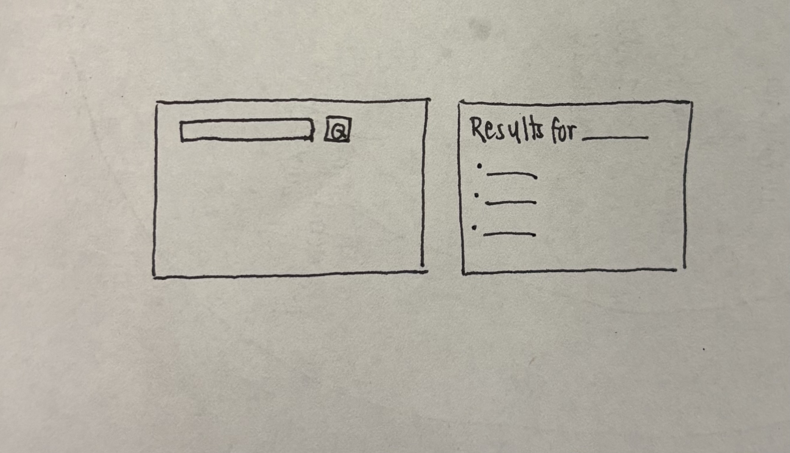

# HW4 Plan

## Who it's for
Art students who want to quickly look up artworks from the Art Institute of Chicago and see who made them and when, so they can study artists' choices.

## 1. Sketch

## 2. Data I need
From the Art Institute API, for each artwork:
- title: so the user can identify the artwork
- artist_title: to credit the artist, so the user can learn more about them and their artistic choices
- date_display: to understand the context the artwork was made in

Some artworks are missing these fields, so I'll show a default instead:
"Untitled", "Unknown artist", or "Unknown date".

## 3. Specs

### search_art(term) in api.py
- In: a search word (string)
- Out: a list of artwork dictionaries, or None if the API fails
- Checks:
  1. Search "monet" → see a list of Monet artworks
  2. Break the URL → returns None, and the page shows an error message
  3. Search "zzzzqqq" → returns an empty list

### / route (home)
- In: nothing (or a message, when /results sends the user back)
- Out: home.html with a labeled search box and a Search button, plus the message if there is one
- Checks:
  1. Open http://127.0.0.1:5000 → see the search form
  2. Press Tab → focus moves to the search box, then the button
  3. Submit an empty form → come back here and see "Please type a search word."

### /results route
- In: the search word the user typed in the form
- Out: results.html listing each artwork's title, artist, and date.
  If something goes wrong, go back to home.html with a message:
  - empty input → "Please type a search word."
  - API error → "We couldn't reach the Art Institute right now. Please try again later."
  - no results → "No artworks found for '___'. Try another word."
- Checks:
  1. Search "monet" → see Monet artworks with title, artist, and date
  2. Search "zzzzqqq" → see the "No artworks found" message
  3. An artwork with no date → shows "Unknown date" instead of a blank

  ## Checks (run in the browser)
- Search "monet" → Monet artworks with title, artist, date: **Pass**
- Empty search → "Please type a search word.": **Pass**
- Broken URL → "couldn't reach" error message: **Pass**
- No results (temporary `return []`) → "No artworks found" message: **Pass**
- Search "zzzzqqq" → **Fail**: the API's fuzzy search still returns artworks
- Missing artist/date → shows "Unknown artist" / "Unknown date": **Pass**
- Tab → search box, then button; Enter searches: **Pass**