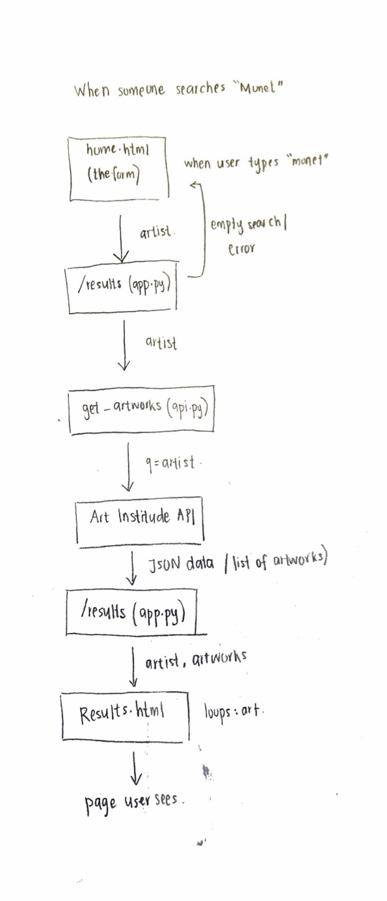

# HW5 findings

## 1. Drawing: one search for "Monet"

## 2. Two questions about the code
1. methods=["GET", "POST"]. Why are both methods written in /results
2. what does response.raise_for_status() do?

## 3. Checks (4 or more, at least 2 as pytest tests)
| # | Check | Pass or fail |
|---|---|---|
| 1 | (pytest) Home page shows the search form with an "Artist name" label | Pass |
| 2 | (pytest) Empty search → "No search term entered" message | Pass |
| 3 | (pytest) Search "Monet" → results page with artworks listed | Pass |
| 4 | (pytest) Made-up word "zzzz" → "No results found" | **Fail**: it showed real artworks (like American Gothic). The API's fuzzy search returns weak matches: "zzzz" scored about 0.000025 vs. about 130 for "monet", but the app shows them anyway. |
| 5 | API error (broken URL) → friendly message | **Fail**: it shows a technical error ("500 Server Error...") and the full API URL. |
| 6 | Each artwork shows its image (from prompt.md) | **Fail**: images show as broken boxes with a "?" and only the alt text. |

## 4. AI review
What it found that I missed: 
- The results page never shows who made each artwork. The app asks the API for
  `artist_title`, but `results.html` doesnt displays it, so users can't tell which
  results are actually by the artist they searched.
- `app.run(debug=True)` (app.py, line 26). Debug mode is fine on my laptop, but if the
  app were put online, the error page would let anyone run code on the server.
What it got wrong:
The AI only read the code and never ran the app, so it said the image code "looks
right" and was only unsure whether images load. When I actually tested it, every image 
showed as a broken box with a "?"
Answers to my two questions, in my own words:
1. Flask routes only accept GET by default. The form sends the
   search with POST, so the route has to list POST or it would give an error. Listing
   both lets it work either way
2. response.raise_for_status() checks the status code. If it's an error like 404 or
   500, it stops and gives an error, which goes to the `except` in app.py. If it's 200,
   nothing happens and the code keeps going. It's like my HW4 `if r.status_code != 200`

## 5. My fix
What was wrong: When the API failed, the app showed the raw technical error to the user,
like "Something broke the request: 500 Server Error... for url: https://api.artic.edu/...".
It was confusing and showed the API's address

What I changed: In app.py, in the `except` part of /results, I replaced the raw error with
a friendly message: "We couldn't reach the Art Institute right now. Please try again in a
few minutes." The real error is now printed to the terminal with print(), so the developer
can still see it.

How I checked it works: I broke the URL in api.py (artworksBROKEN), restarted the app and
searched. The page showed the friendly message, and the terminal showed "API error: 500...".
Then I put the URL back and ran python3 -m pytest: 3 tests still passed (the zzzz test
still fails, as before). I also checked the change with git diff.

Commit before: dd8cef6  Commit after: f98a996

## 6. Can we ship it? (100–150 words)
Yes or no, and why:
No, not tomorrow. The app works for a normal search like "Monet," but it has problems a
real user would notice right away. The results never say who made each artwork, even
though this is supposed to be an artist search. The images don't load and show up as
broken boxes. If someone types a typo or a made-up word, the app still shows random
artworks instead of saying "No results found," because nothing checks how good the match
is. The error message was also confusing until I fixed it, and debug=True is risky if the
app goes online. I would fix the artist name, the images, and the weak matches first.

One thing my HW4 does better: it shows the artist for every artwork, and it gives a clear,
friendly message for each problem (empty search, API error, no results)

One thing the AI's app does better: it tries to show an image for each artwork, with
"No image available" and "Date unknown" when that information is missing. My HW4 didn't
show images at all.

AI use goes in `ai_use.md` (the five points on the AI Use Card).
